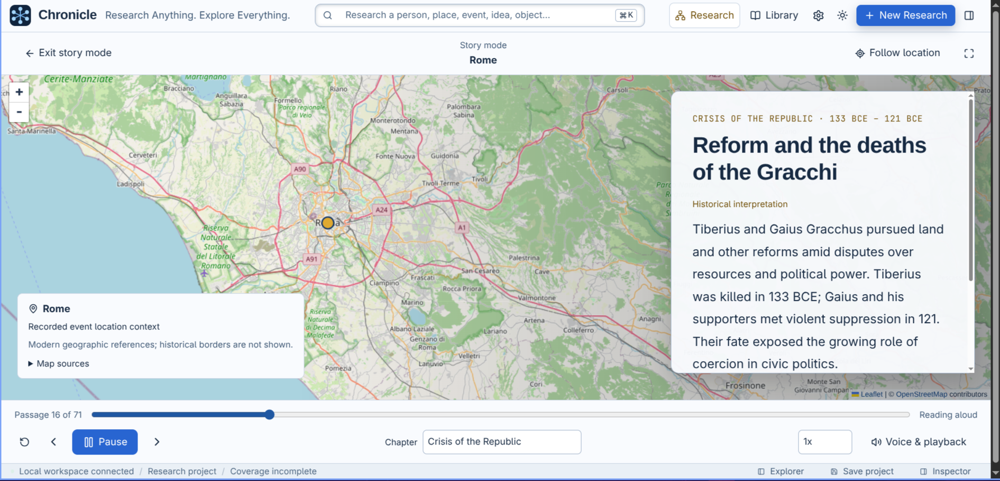
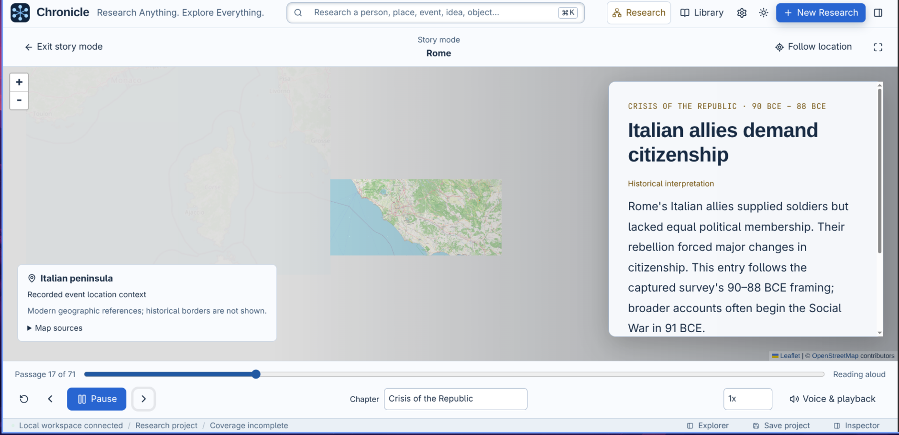
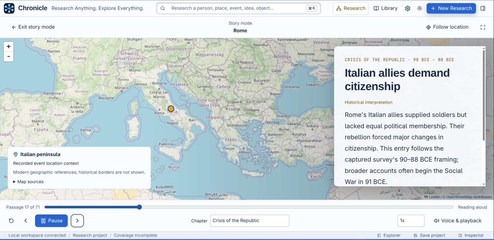

# Chronicle

**Explore Céline Dion's life. Rebuild and play any subject's story with AI.**

From Québec to Eurovision and the world stage, follow Céline Dion's performances,
travels, collaborators, and milestones through a timeline you can play aloud.

Chronicle is a local academic research workspace that automatically investigates
a subject's documented history and rebuilds its story with sources you can inspect.
Built for students, educators, researchers, and curious minds.


## Research anything

People, families, places, institutions, events, inventions, species, objects, ideas,
and creative works. Study their origins, development, relationships, turning points,
historical context, and legacy or latest documented state.

## Rebuild the life. Play the story.

- **Automatic AI research:** enter a subject; Chronicle plans questions, searches sources, retrieves passages, and assembles chronological records.
- **Interactive histories:** explore events, relationships, works, and eras in a graph with date filters and adjustable detail.
- **Story playback:** read or listen to chapters while the timeline follows along; choose a perspective and reading speed.
- **Story mode:** follow a subject through time and place with narrated passages over a map that moves to each event's recorded locations.
- **Maps and media:** trace documented visits and connect images, music videos, and performances to their place in the story.
- **Academic exploration:** inspect source passages, compare competing claims, and preserve uncertain dates and coverage gaps.
- **Your research workspace:** annotate, save, import, and export projects; resize panes and switch themes.

| Map documented visits | Explore music and videos |
| --- | --- |
|  |  |

## Follow the story through time and place

Open **Story** in Explorer or choose **Story mode** above the Story pane. Read or
listen as the subject's timeline advances through passages and chapters. The map
follows the current event's recorded places, moving between city views and broader
regional context as the story unfolds.

This keeps the where alongside the when: follow a person's changing surroundings,
an institution's reach, or the geographic setting of a historical turning point.
In the Rome example, the story moves from events in the city to developments across
the Italian peninsula, helping connect a local episode with its wider setting.



| Moving to the next location | The wider regional setting |
| --- | --- |
|  |  |

Pause, skip passages, seek along the story, choose a chapter, or adjust the voice
and speed. Switch off **Follow location** to explore the map yourself, or expand
the player to fullscreen. Opening Story mode keeps the current passage and playback.

Research supplies geographic references from sources you can inspect under
**Map sources**. Several recorded locations are framed together; missing locations
use the wider story context. Regional markers are representative points, and the
modern base map does not reconstruct historical borders. [Story mode guide](docs/maps.md#story-mode).

## Start researching

Requires **Node.js 22+** and **Go 1.26+**.

```sh
npm install
npm run dev
```

Open [localhost:5173](http://localhost:5173). Connect your AI model and MCP search/retrieval
tools in **Settings**, then choose **New Research** and enter a subject.

[Setup](docs/setup.md) · [Research standards](docs/research-standards.md) · [Assistant/MCP tools](docs/assistant-tools.md) · [Maps](docs/maps.md) · [Speech](docs/speech.md) · [Image credits](docs/assets.md)
