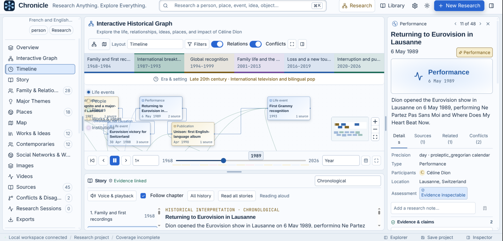
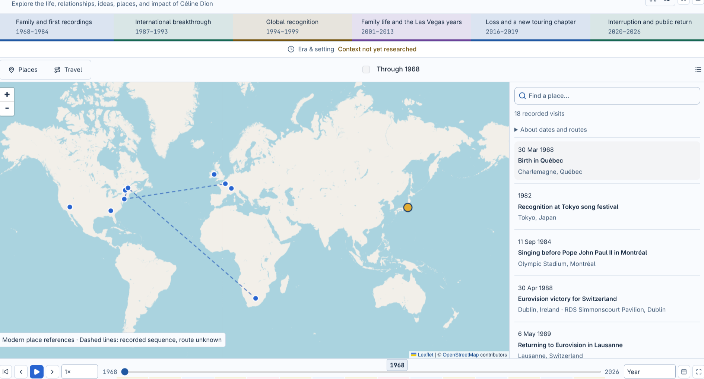
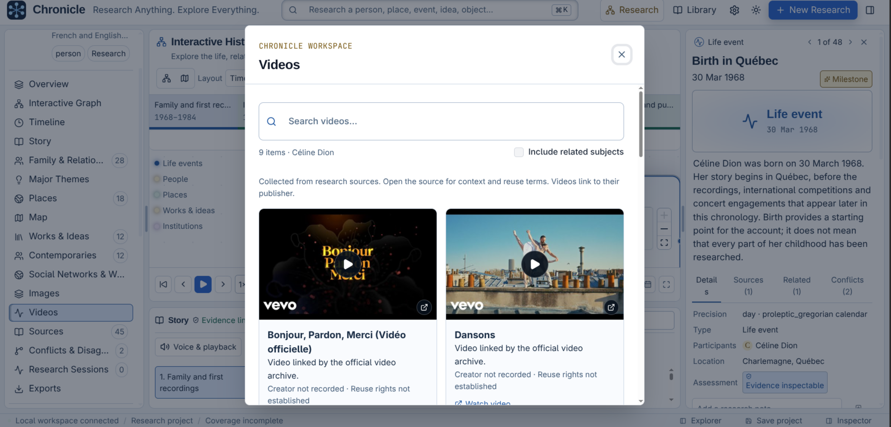

# Chronicle

**Explore Céline Dion's life. Rebuild and play any subject's story with AI.**

From Québec to Eurovision and the world stage, follow Céline Dion's performances,
travels, collaborators, and milestones through a timeline you can play aloud.

Chronicle is a local academic research workspace that automatically investigates
a subject's documented history and rebuilds its story with sources you can inspect.
Built for students, educators, researchers, and curious minds.



## Research anything

People, families, places, institutions, events, inventions, species, objects, ideas,
and creative works. Study their origins, development, relationships, turning points,
historical context, and legacy or latest documented state.

## Rebuild the life. Play the story.

- **Automatic AI research:** enter a subject; Chronicle plans questions, searches sources, retrieves passages, and assembles chronological records.
- **Interactive histories:** explore events, relationships, works, and eras in a graph with date filters and adjustable detail.
- **Story playback:** read or listen to chapters while the timeline follows along; choose a perspective and reading speed.
- **Maps and media:** trace documented visits and connect images, music videos, and performances to their place in the story.
- **Academic exploration:** inspect source passages, compare competing claims, and preserve uncertain dates and coverage gaps.
- **Your research workspace:** annotate, save, import, and export projects; resize panes and switch themes.

| Map documented visits | Explore music and videos |
| --- | --- |
|  |  |

## Start researching

Requires **Node.js 22+** and **Go 1.26+**.

```sh
npm install
npm run dev
```

Open [localhost:5173](http://localhost:5173). Connect your AI model and MCP search/retrieval
tools in **Settings**, then choose **New Research** and enter a subject.

[Setup](docs/setup.md) · [Research standards](docs/research-standards.md) · [Assistant/MCP tools](docs/assistant-tools.md) · [Maps](docs/maps.md) · [Speech](docs/speech.md) · [Image credits](docs/assets.md)
